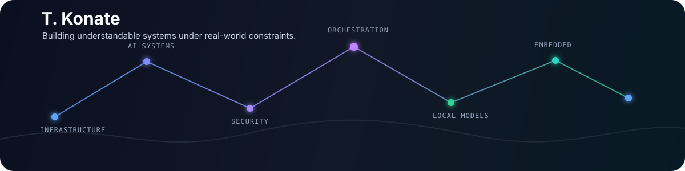

**Computer Science & Electronics Student**

I build and document self-hosted systems, AI agents and security tooling.

[Projects](#featured-projects) · [Focus](#what-i-build) · [Currently building](#currently-building) · [How I work](#how-i-work)

## What I build

<table>
<tr>
<td width="50%">

### 🖥️ Self-hosted infrastructure

Linux, Docker, private networking and persistent services.

</td>
<td width="50%">

### 🤖 AI systems

Agents, orchestration, LLM routing and local inference.

</td>
</tr>
<tr>
<td width="50%">

### 🔐 Security tooling

Automation, hardening and technical security research.

</td>
<td width="50%">

### ⚡ Electronics & embedded

Homelabs, microcontrollers and physical experimentation.

</td>
</tr>
</table>

## Featured projects

<table>
<tr>
<td width="50%" valign="top">

### [Problem Radar](https://github.com/TKonate/problem-radar)

Turns public issue trackers and forums into ranked, sourced problem leads, with a score that explains itself and refuses to decide for you.

Python · Public APIs · Clustering · Explainable scoring · 168 tests

</td>
<td width="50%" valign="top">

### [Portfolio Manager](https://github.com/TKonate/portfolio-manager)

CLI and local web UI to create, check, index and publish a Markdown portfolio. Zero runtime dependencies.

Python · CLI · Web UI · 286 tests · 94% coverage

</td>
</tr>
<tr>
<td width="50%" valign="top">

### [LLM Trading Bench](https://github.com/TKonate/llm-trading-bench)

Multi-agent paper-trading benchmark: every model gets the same tools, the same data and the same rules. Results are scored against the market and against random portfolios.

Python · AI agents · Tool calling · Benchmarks · 106 tests

</td>
<td width="50%" valign="top">

### [Ollama Inference Benchmarks](https://github.com/TKonate/ollama-inference-benchmarks)

CPU-only inference benchmarks: time to first token, real generation throughput and reproducible campaigns on hardware you already own.

Ollama · Local AI · Benchmarks · v0.5.0

</td>
</tr>
<tr>
<td width="50%" valign="top">

### [Hermes Infrastructure](https://github.com/TKonate/hermes-infrastructure)

Sanitized architecture study for a self-hosted AI agent infrastructure.

Self-hosted · Docker · Networking · AI agents

</td>
<td width="50%" valign="top">

### [Palantir Research Workflow](https://github.com/TKonate/palantir-research-workflow)

Case study of a structured web-research workflow for multi-agent systems.

Research · OSINT · Automation · Documentation

</td>
</tr>
</table>

[More projects →](https://github.com/TKonate?tab=repositories) — work in progress stays private until it builds and is reproducible.

## Currently building

- Running a weekly problem radar over public issue trackers, and reporting what recurs
- Extending the Hermes infrastructure documentation
- Exploring LLM routing and local inference evaluation
- Developing authorized security experiments

## How I work

I prefer small, understandable systems, documented decisions and measured results. I treat constraints, failures and trade-offs as part of the engineering work—not as details to hide.

## Outside the code

I am especially interested in the intersection of software, infrastructure, cybersecurity, electronics and human systems.

**More projects will be published as they become reproducible and well documented.**

